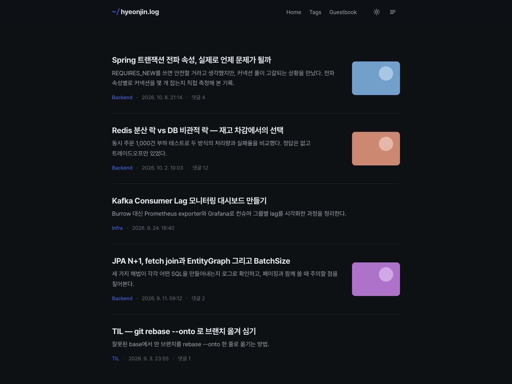

# TildeDev

개발/기술 블로그용 미니멀 티스토리 스킨.



## 기능

**레이아웃**
- 1단 레이아웃 + 오른쪽 서랍 사이드바 (프로필 · 검색 · 메뉴 · 카테고리 · 최근 글 · 태그 · 방문자)
- 라이트/다크 전환 (OS 설정 감지, 선택값은 브라우저 `localStorage`의 `tildedev-theme`에 저장, 깜빡임 없음)
- 반응형 (767px 이하에서 상단 메뉴는 서랍으로 이동)

**글 상세**
- 목차(TOC): h2~h4 기반, 현재 섹션 하이라이트, 1200px 이상에서 본문 오른쪽에 표시
- 읽기 진행바, 읽기 시간(`⏱ N min read`)
- 코드블록: highlight.js 하이라이팅(테마 색은 CSS 변수) + 언어 라벨 + Copy 버튼
- 표: 에디터가 넣는 고정 높이를 무시해 항상 전체 표시, 화면보다 넓은 표만 가로 스크롤
- 이전/다음 글 카드(긴 제목은 말줄임표), 같은 카테고리 관련 글 목록
- 인용구 3종 지원: 따옴표(위아래 “ ”, 가운데 정렬) · 세로 바 · 박스

**티스토리 자동 삽입 영역**
- 블로그 소개 카드(네임카드): 테마 색 카드, 원형 프로필 사진 세로 가운데 정렬
- 댓글: 목록 · 입력칸 · 로그인 닉네임 · 등록 버튼을 테마 색으로 재스타일 (다크모드 대응)
- 인용문: 티스토리 기본 글자색(#666/#333)과 박스 배경을 테마 색으로 덮어씀
- '카테고리의 다른 글' 블록은 숨기고 스킨의 관련 글 목록으로 대체
- 본문 아래 공감 · 공유 · 통계 · 더보기 버튼 묶음은 티스토리 기본 UI를 그대로 사용 (라이트/다크 모두 정상 표시)
- 티스토리 CSS가 스킨 CSS보다 늦게 로드되므로 이 영역의 스타일은 `!important`로 덮어씀

**기타**
- 단축키: `/` 검색, `Esc` 서랍 닫기
- 푸터: `© {올해} {블로그 제목}. All rights reserved.` + GitHub 링크 (연도는 스크립트로 자동 갱신)
- 맨 위로 버튼, 인쇄용 스타일

## 파일 구조

```
skin.html          HTML 템플릿
style.css          스타일 (색상 토큰은 상단 :root / [data-theme="dark"])
index.xml          스킨 정보 + 스킨 옵션(강조 색상, 기본 테마, 썸네일 표시)
images/script.js   테마 · 서랍 · 코드블록 · 표 · 목차 · 진행바 · 읽기 시간 · 푸터 연도
preview*.jpg/.gif  스킨 목록 썸네일 (스킨 등록용)
preview/build.py   로컬 미리보기 생성기 (티스토리 업로드 대상 아님)
```

## 다운로드

```bash
git clone https://github.com/hikhjin/tildedev-tistory-theme.git
```

또는 [저장소](https://github.com/hikhjin/tildedev-tistory-theme) 페이지에서 **Code > Download ZIP**.

## 적용

### 방법 1: 스킨 등록 (권장)

1. 티스토리 관리자 → **꾸미기 > 스킨 변경 > 스킨 등록**
2. **추가**로 아래 8개 파일 업로드
   - `skin.html`, `style.css`, `index.xml`, `images/script.js` (`images` 폴더가 아니라 안의 파일을 선택)
   - `preview.gif`, `preview256.jpg`, `preview560.jpg`, `preview1600.jpg`
3. 파일목록에 8개가 모두 있는지 확인 후 **저장**
4. **꾸미기 > 스킨 변경 > 스킨 보관함**에서 TildeDev 선택 후 **적용**

### 방법 2: 스킨 편집

1. 현재 스킨을 스킨 보관함에 백업
2. **꾸미기 > 스킨 편집 > html 편집**
3. HTML 탭에 `skin.html`, CSS 탭에 `style.css` 전체 붙여넣기
4. 파일업로드 탭에 `index.xml`, `images/script.js` 업로드 (`script.js`는 `images/` 경로로 올라감)
5. **적용**

### 적용 후 설정

- **스킨 편집 > 스킨 옵션**: 강조 색상 · 기본 테마(시스템/라이트/다크) · 목록 썸네일 표시
- **꾸미기 > 메뉴**: 상단 메뉴와 서랍의 Menu에 표시될 항목
- **꾸미기 > 사이드바**: 서랍에 표시될 모듈 순서
- **메뉴바/구독 버튼 위치**: **오른쪽 상단**은 헤더 버튼과 겹칠 수 있으니 다른 위치 권장

### 업데이트

스킨 편집에서 바뀐 파일만 교체하면 됩니다.

| 바뀐 파일 | 교체 방법 |
|---|---|
| `skin.html` | HTML 탭에 다시 붙여넣기 |
| `style.css` | CSS 탭에 다시 붙여넣기 |
| `images/script.js`, `index.xml` | 파일업로드 탭에서 새 파일로 교체 |

> `index.xml`이 바뀌면 티스토리 정책상 스킨 옵션(강조 색상 · 기본 테마 · 썸네일 표시)이 초기화되니 다시 지정하세요.

## 커스터마이징

- **색상**: `style.css` 상단 `:root`(라이트) / `[data-theme="dark"]`(다크)의 변수 수정. 강조 색은 스킨 옵션에서 변경 가능
- **폰트**: 본문 [Pretendard](https://github.com/orioncactus/pretendard), 코드 · 라벨 [JetBrains Mono](https://www.jetbrains.com/lp/mono/). `style.css`의 `--font-sans`, `--font-mono`와 `skin.html`의 폰트 `<link>` 수정
- **푸터**: `skin.html` 하단 `<footer>`에서 저작권 문구와 GitHub 링크 수정. 블로그 이름은 `[##_title_##]`(티스토리 블로그 제목)를 따름

## 로컬 미리보기

프로젝트 루트에서 실행합니다.

```bash
python3 preview/build.py && python3 -m http.server 4173
```

- 목록: `http://localhost:4173/preview/index.html`
- 글 상세: `http://localhost:4173/preview/post.html`

`style.css` · `script.js` 수정은 새로고침만, `skin.html` 수정은 `build.py`를 다시 실행하세요. 생성된 HTML은 `.gitignore`로 제외됩니다. 치환자를 더미 값으로 채운 것이라 실제 티스토리 출력과 차이가 있어요. 특히 네임카드 · 댓글 · 공감 버튼처럼 티스토리가 런타임에 넣는 영역은 미리보기에 없으니 실제 블로그에서 확인하세요.

## 라이선스

© 2026 [hikhjin](https://github.com/hikhjin). All rights reserved.

**허용**
- 개인 블로그에 적용
- 본인 블로그에 맞게 수정

**금지**
- 상업적 이용 및 유료 판매
- 스킨 파일 또는 수정본 재배포 (공유할 때는 이 저장소 링크로)
